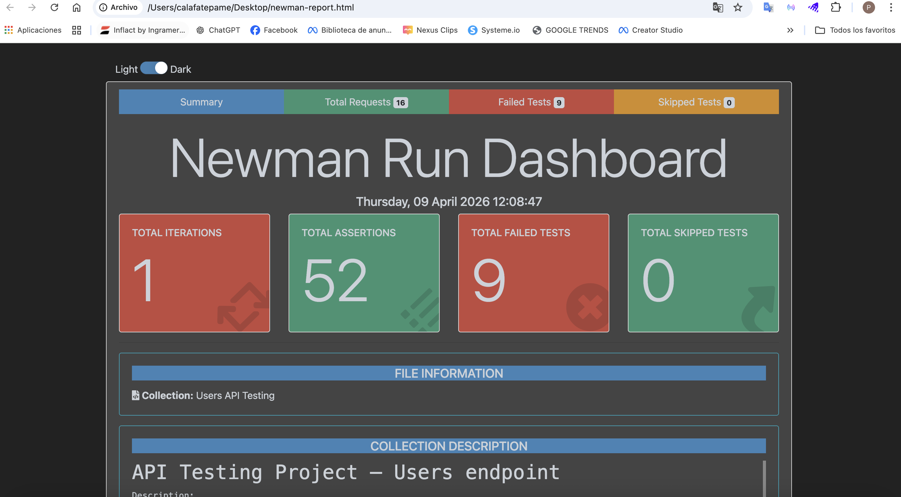

# QA API Testing Project – Users API

[Read this documentation in Spanish](README_ES.md)

## 1. Project Overview

This project focuses on API testing of the Users resource from [JSONPlaceholder](https://jsonplaceholder.typicode.com/), a public testing API.

The goal is to practice API testing techniques, design functional and negative test scenarios, automate test execution, and document differences between expected and actual API behavior.

**API endpoint:**

`https://jsonplaceholder.typicode.com/users`


## 2. Quick Start

### Prerequisites
- Node.js
- Newman

### Install Newman

```bash
npm install -g newman
```

### Run the API tests

```bash
newman run collection/users-api-testing.postman_collection.json
```

### Analyzed test execution

| Metric | Result |
|---|---:|
| API requests | 16 |
| Assertions | 58 |
| Passed assertions | 48 |
| Failed assertions | 10 |

Note: Failed assertions represent differences between expected and observed behavior in JSONPlaceholder, a public testing API. They are not confirmed defects in a production system.


## 3. Project Objectives

- Design and execute positive and negative test cases.
- Validate REST API responses.
- Verify HTTP status codes, response structure and data types.
- Explore input validation and error handling.
- Automate test execution using Postman and Newman.
- Integrate automated execution with GitHub Actions.
- Document test results and API findings.

## 4. Tools and Technologies

| Tool | Purpose |
|---|---|
| Postman | API requests and test scripts |
| Newman | Command-line test execution |
| GitHub | Version control and project documentation |
| GitHub Actions | Continuous integration |
| Markdown | QA documentation |
| JSONPlaceholder | API under test |

## 5. Test Scope

Testing was performed on the `/users` resource using GET and POST requests.

The following aspects were evaluated:

- HTTP status codes.
- Response time.
- JSON response structure.
- Required fields.
- Data types.
- Existing and non-existing resources.
- Invalid input values.
- Empty and incomplete request bodies.
- Boundary and negative scenarios.

### Out of Scope

- Authentication and authorization.
- Security testing.
- Load and advanced performance testing.
- User interface testing.
- Actual persistence of created users.

## 6. Test Cases

The Postman collection contains 16 test cases.

| ID | Scenario |
|---|---|
| TC01 | Retrieve all users |
| TC02 | Retrieve a user by valid ID |
| TC03 | Retrieve a non-existing user |
| TC04 | Retrieve a user using an alphabetical ID |
| TC05 | Retrieve a user with ID 0 |
| TC06 | Retrieve a user with a negative ID |
| TC07 | Retrieve a user with a decimal ID |
| TC08 | Retrieve users without an ID parameter |
| TC09 | Create a user with valid data |
| TC10 | Create a user without an email field |
| TC11 | Create a user with an empty request body |
| TC12 | Create a user with an invalid data type |
| TC13 | Create a user with an invalid email format |
| TC14 | Send malformed JSON |
| TC15 | Create a user with empty fields |
| TC16 | Create a user with a long name |

## 7. Test Execution Results

The analyzed Newman execution produced the following results:

| Metric | Result |
|---|---:|
| Requests executed | 16 |
| Assertions executed | 58 |
| Passed assertions | 48 |
| Failed assertions | 10 |
| Request-level errors | 0 |
| Average response time | 172 ms |

The failed assertions were mainly related to input validation expectations and the response to malformed JSON.

These results represent one execution against JSONPlaceholder. They do not indicate defects in a production application.

## 8. API Findings

The following behaviors were observed:

- The API accepted a request without an email field.
- The API accepted an empty request body.
- The API preserved a numeric value in the email field.
- The API accepted an invalid email format.
- The API returned HTTP 500 when receiving malformed JSON.

These findings document differences between the expected results defined for this exercise and the actual API responses.

See the detailed findings in [API Findings](docs/en/api-findings.md).

## 9. Test Automation

The Postman collection includes automated assertions to validate:

- Expected HTTP status codes.
- Response time.
- JSON structure.
- Required properties.
- Data types.
- Response content.

### Run tests locally

Make sure Node.js and Newman are installed.

Install Newman:

```bash
npm install -g newman
```

Run the collection:

```bash
newman run collection/users-api-testing.postman_collection.json
```

## 10. CI/CD Integration

A GitHub Actions workflow is configured to execute the Postman collection with Newman on pushes to the `main` branch.

Workflow file:

`.github/workflows/api-tests.yml`

The workflow installs Node.js and Newman before running the automated collection.

## 11. Test Evidence

The repository includes execution screenshots and a Newman HTML report.

- [Newman HTML Report](reports/newman-report.html)
- [Execution Evidence](evidence/)



## 12. QA Documentation

Detailed documentation is available in English and Spanish.

### English

- [Test Plan](docs/en/test-plan.md)
- [Test Cases](docs/en/test-cases.md)
- [API Findings](docs/en/api-findings.md)

### Spanish

- [Plan de Pruebas](docs/es/plan-de-pruebas.md)
- [Casos de Prueba](docs/es/casos-de-prueba.md)
- [Hallazgos de la API](docs/es/hallazgos-api.md)

## 13. Testing Techniques

- Functional Testing.
- Positive Testing.
- Negative Testing.
- Boundary Value Analysis.
- Response Validation.
- Equivalence Partitioning.

## 14. Author

QA API testing practice project developed as part of my professional learning journey in Quality Assurance.

**Focus:** API Testing | Postman | Newman | Test Case Design | GitHub Actions