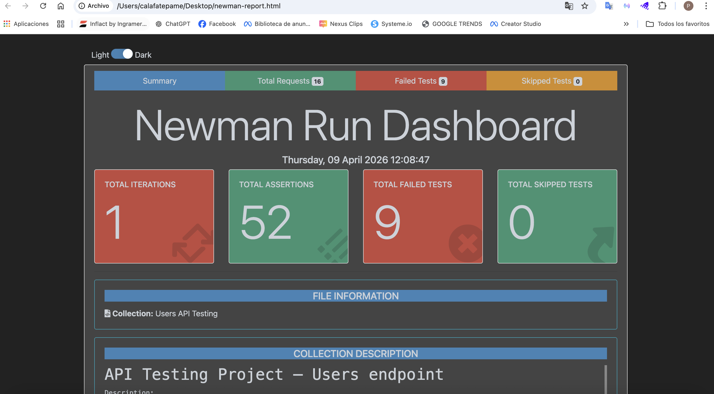

# Proyecto de QA API Testing – Users API

[Read this documentation in English](README.md)

## 1. Descripción del Proyecto

Este proyecto está orientado al testing de APIs sobre el recurso Users de [JSONPlaceholder](https://jsonplaceholder.typicode.com/), una API pública de pruebas.

El objetivo es practicar técnicas de API Testing, diseñar escenarios funcionales y negativos, automatizar la ejecución de pruebas y documentar las diferencias entre los resultados esperados y el comportamiento observado.

**Endpoint de la API:**

`https://jsonplaceholder.typicode.com/users`


## 2. Inicio rápido

### Requisitos previos
- Node.js
- Newman

### Instalar Newman

```bash
npm install -g newman
```

### Ejecutar las pruebas de API

```bash
newman run collection/users-api-testing.postman_collection.json
```

### Ejecución analizada

| Métrica | Resultado |
|---|---:|
| Solicitudes API | 16 |
| Aserciones | 58 |
| Aserciones aprobadas | 48 |
| Aserciones fallidas | 10 |

Nota: Las aserciones fallidas representan diferencias entre el comportamiento esperado y el observado en JSONPlaceholder, una API pública de pruebas. No constituyen defectos confirmados en un sistema de producción.


## 3. Objetivos del Proyecto

- Diseñar y ejecutar casos de prueba positivos y negativos.
- Validar respuestas de APIs REST.
- Verificar códigos de estado HTTP, estructura de respuestas y tipos de datos.
- Explorar validaciones de entradas y manejo de errores.
- Automatizar la ejecución de pruebas con Postman y Newman.
- Integrar la ejecución automatizada mediante GitHub Actions.
- Documentar resultados y hallazgos de la API.

## 4. Herramientas y Tecnologías

| Herramienta | Uso |
|---|---|
| Postman | Solicitudes API y scripts de prueba |
| Newman | Ejecución de pruebas desde línea de comandos |
| GitHub | Control de versiones y documentación |
| GitHub Actions | Integración continua |
| Markdown | Documentación de QA |
| JSONPlaceholder | API bajo prueba |

## 5. Alcance de las Pruebas

Se realizaron pruebas sobre el recurso `/users` mediante solicitudes GET y POST.

Se evaluaron los siguientes aspectos:

- Códigos de estado HTTP.
- Tiempo de respuesta.
- Estructura de respuestas JSON.
- Campos requeridos.
- Tipos de datos.
- Recursos existentes e inexistentes.
- Valores de entrada inválidos.
- Cuerpos de solicitud vacíos e incompletos.
- Escenarios negativos y valores límite.

### Fuera del alcance

- Pruebas de autenticación y autorización.
- Pruebas de seguridad.
- Pruebas de carga y rendimiento avanzado.
- Pruebas de interfaz de usuario.
- Persistencia real de usuarios creados.

## 6. Casos de Prueba

La colección de Postman contiene 16 casos de prueba.

| ID | Escenario |
|---|---|
| TC01 | Obtener todos los usuarios |
| TC02 | Obtener usuario por ID válido |
| TC03 | Obtener usuario inexistente |
| TC04 | Obtener usuario con ID alfabético |
| TC05 | Obtener usuario con ID 0 |
| TC06 | Obtener usuario con ID negativo |
| TC07 | Obtener usuario con ID decimal |
| TC08 | Obtener usuarios sin parámetro ID |
| TC09 | Crear usuario con datos válidos |
| TC10 | Crear usuario sin campo email |
| TC11 | Crear usuario con body vacío |
| TC12 | Crear usuario con tipo de dato inválido |
| TC13 | Crear usuario con formato de email inválido |
| TC14 | Enviar JSON malformado |
| TC15 | Crear usuario con campos vacíos |
| TC16 | Crear usuario con nombre extenso |

## 7. Resultados de Ejecución

La ejecución de Newman analizada produjo los siguientes resultados:

| Métrica | Resultado |
|---|---:|
| Solicitudes ejecutadas | 16 |
| Aserciones ejecutadas | 58 |
| Aserciones aprobadas | 48 |
| Aserciones fallidas | 10 |
| Errores de ejecución de solicitudes | 0 |
| Tiempo promedio de respuesta | 172 ms |

Las aserciones fallidas estuvieron principalmente relacionadas con las expectativas de validación de datos y la respuesta ante JSON malformado.

Estos resultados corresponden a una ejecución contra JSONPlaceholder. No representan necesariamente defectos de una aplicación productiva.

## 8. Hallazgos de la API

Durante las pruebas se observaron los siguientes comportamientos:

- La API aceptó una solicitud sin el campo email.
- La API aceptó un body vacío.
- La API conservó un valor numérico en el campo email.
- La API aceptó un email con formato inválido.
- La API devolvió HTTP 500 al recibir JSON malformado.

Estos hallazgos documentan diferencias entre los resultados esperados definidos para este ejercicio y las respuestas reales de la API.

Para consultar el detalle, ver [Hallazgos de la API](docs/es/hallazgos-api.md).

## 8. Automatización de Pruebas

La colección de Postman contiene aserciones automatizadas para validar:

- Códigos de estado HTTP esperados.
- Tiempo de respuesta.
- Estructura JSON.
- Propiedades requeridas.
- Tipos de datos.
- Contenido de las respuestas.

### Ejecución local

Es necesario tener Node.js y Newman instalados.

Instalar Newman:

```bash
npm install -g newman
```

Ejecutar la colección:

```bash
newman run collection/users-api-testing.postman_collection.json
```

## 10. Integración CI/CD

El repositorio cuenta con un workflow de GitHub Actions configurado para ejecutar la colección de Postman mediante Newman cuando se realizan cambios mediante push a la rama `main`.

Archivo del workflow:

`.github/workflows/api-tests.yml`

El workflow instala Node.js y Newman antes de ejecutar la colección automatizada.

## 11. Evidencias de Ejecución

El repositorio incluye capturas de pantalla de las ejecuciones y un reporte HTML de Newman.

- [Reporte HTML de Newman](reports/newman-report.html)
- [Carpeta de evidencias](evidence/)



## 12. Documentación de QA

La documentación detallada está disponible en español e inglés.

### Español

- [Plan de Pruebas](docs/es/plan-de-pruebas.md)
- [Casos de Prueba](docs/es/casos-de-prueba.md)
- [Hallazgos de la API](docs/es/hallazgos-api.md)

### English

- [Test Plan](docs/en/test-plan.md)
- [Test Cases](docs/en/test-cases.md)
- [API Findings](docs/en/api-findings.md)

## 13. Técnicas de Testing Aplicadas

- Pruebas funcionales.
- Pruebas positivas.
- Pruebas negativas.
- Análisis de valores límite.
- Validación de respuestas.
- Partición de equivalencia.

## 14. Autora

Proyecto práctico de API Testing desarrollado como parte de mi proceso de formación profesional en Quality Assurance.

**Enfoque:** API Testing | Postman | Newman | Diseño de casos de prueba | GitHub Actions